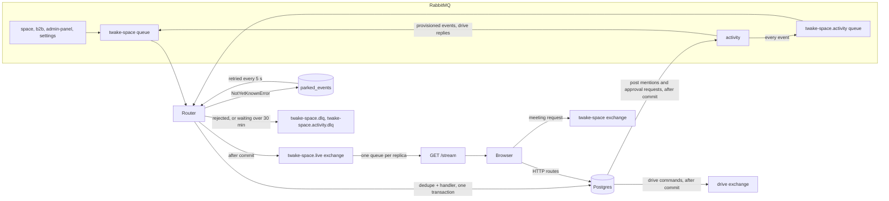
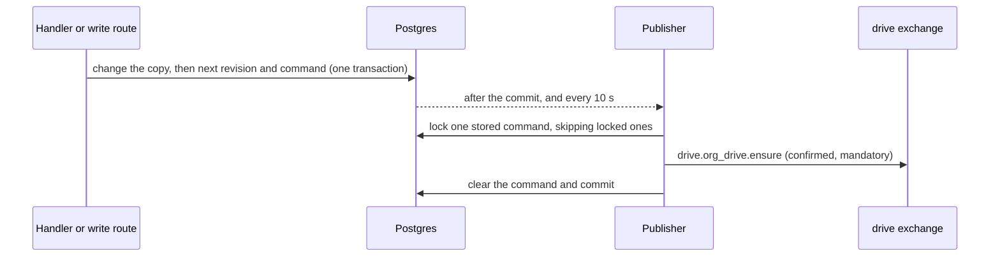
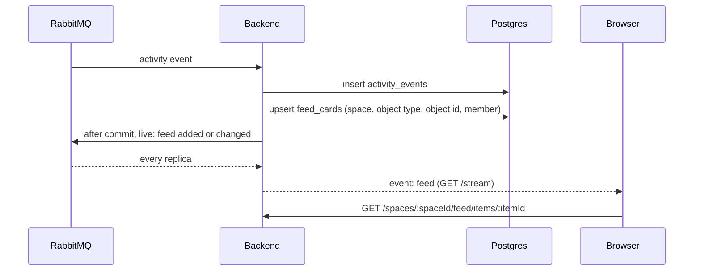
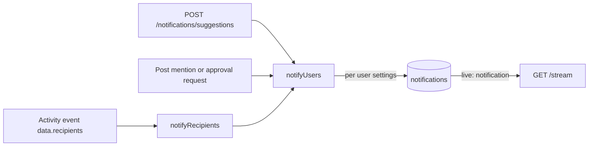
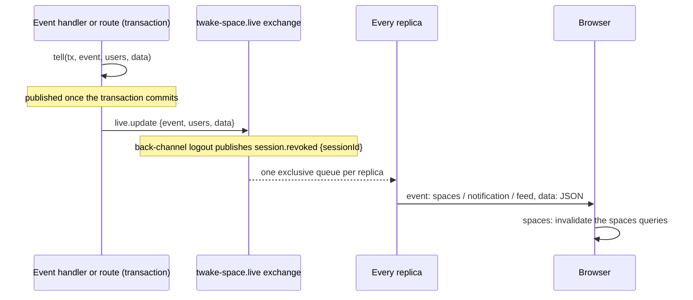

# Events

How events reach Twake Space, what the backend does with them, and how the result reaches the browser.

## Terms

- Platform event: a RabbitMQ message from ldap-rest or another platform service (exchanges `space`, `b2b`, `admin-panel`, `settings`). It has a routing key, a message id, and a JSON body.
- Activity event: a CloudEvent (specversion `1.0`) an app publishes on the `activity` exchange, with the CloudEvent `type` as routing key.
- Copy: the backend's Postgres copy of organizations, spaces, members, linked groups and resources.
- Card: a space feed item showing the activity events about one object, stored in `feed_cards` and pointing at the object's latest event in `activity_events`.
- Post: a space feed item a member writes, stored in `feed_posts`.
- Live event: a message the backend pushes to a browser over SSE: `spaces`, `notification` or `feed`.

## Overview



## Consuming RabbitMQ

The backend consumes two queues through [@linagora/rabbitmq-client](https://github.com/linagora/rabbitmq-client/tree/v0.7.1), each on its own connection:

- `twake-space` takes the events whose order matters: the platform events, the apps' provisioned events, which follow the space's creation, and Drive's replies.
- `twake-space.activity` takes every activity event, and handles all but the provisioned events and Drive's replies, which it leaves unrouted. Each one stands alone, so every replica consumes it.

At startup the backend declares `twake-space` and binds it to each platform event it handles, routing key equal to the event name:

- `space`: `twake.space.created`, `twake.space.updated`, `twake.space.deleted`, `twake.space.member.added`, `twake.space.member.role.changed`, `twake.space.member.removed`, `twake.space.group.linked`, `twake.space.group.role.changed`, `twake.space.group.unlinked`
- `b2b`: `b2b.group.updated`, `b2b.member.role.changed`, `b2b.member.disabled`, `domain.user.deleted`, `domain.organization.deleted`, `chat.deprovision`, `chat.deployment.completed`, `chat.deployment.updated`
- `admin-panel`: `dns.validated`
- `settings`: `user.settings.updated`
- `activity`: `com.twake.*.space.provisioned.v1` and `com.twake.drive.org_drive.#` (`AMQP_PROVISIONED_BINDING` and `AMQP_DRIVE_REPLIES_BINDING`)

It declares `twake-space.activity` with one binding, `#` on `activity`. Older versions bound that key to `twake-space`, and each start removes it from there, once `twake-space.activity` holds those events. `twake-space` still handles the activity events it already held.

Both queues:

- Are quorum queues with a delivery limit of 20 (`AMQP_DELIVERY_LIMIT`).
- Dead-letter to their own exchange, which routes to their own queue: `twake-space.dlx` to `twake-space.dlq`, and `twake-space.activity.dlx` to `twake-space.activity.dlq`. The backend declares them. The dead letter routing key is the queue's first binding, with `.dead` appended (`twake.space.created.dead` and `#.dead`).
- Have the client's other arguments, `x-overflow: reject-publish` and `x-dead-letter-strategy: at-least-once`.
- Get each message acknowledged only after its Postgres transaction commits.

`twake-space` has a single active consumer, with prefetch 1, so its messages are handled one at a time, in the order they were published. Each replica consumes `twake-space.activity` with prefetch 10 (`AMQP_ACTIVITY_CONCURRENCY`), and handles up to 10 of its messages at once.

Startup fails when `space`, `b2b`, `admin-panel`, or an exchange `AMQP_EVENTS` moves an event to, is missing, since other services own them. The backend declares `activity` and `settings` itself, as durable topic exchanges: the apps declare `activity` the same way, and declaring `settings` lets the backend run on a platform without common settings.

Every name above is a setting, listed in [Deploying](deploy.md#rabbitmq-names). The router and the handlers always see the default routing keys and the default `activity` name: the consumer translates them back before routing. A renamed platform exchange is kept as is, so `parked_events` rows and log lines show the deployment's name.

Local `docker-compose.yml` runs RabbitMQ and declares the exchanges the backend only checks: these three.

## Routing

The router picks a handler by exchange:

- `activity`: the key is the CloudEvent `type`. The dedupe key is `{ source, id }` of the CloudEvent.
- Any other exchange: the key is the routing key. The dedupe key is `{ source: 'amqp', id: messageId }`.

Each message ends in one outcome:

- processed: the handler ran.
- duplicate: `processed_events` already holds `(consumer, source, id)`, so the handler did not run.
- unrouted: no handler for the key. Logged at debug and acknowledged.
- malformed: a CloudEvent that does not parse, a platform event without a message id (nor a `request_id` in its body, which stands in for it), or a handler threw `MalformedEventError`. Logged and acknowledged. A body that is not JSON goes to the dead letter queue.
- rejected: a handler threw `RejectedEventError`, or Postgres refused the event's data (an error of class 22, 23 or 54, such as a NUL byte in a preview or a key too long for its index). The message is dead-lettered to its queue's dead letter queue. It carries RabbitMQ's `x-death` header but no reason: the `event rejected` log line has it.
- parked: a handler threw `NotYetKnownError`, because the event is about a space or member the copy does not hold yet. The event goes to the `parked_events` table and is acknowledged. One replica at a time (under an advisory lock) retries parked events, oldest first and up to 100 per pass, 5 seconds after its previous pass ended. One still waiting after 30 minutes, RabbitMQ's default `consumer_timeout`, is published through `twake-space.dlx` to `twake-space.dlq`, whichever queue it came from, with its message id and the headers `x-twake-space-exchange`, `x-twake-space-routing-key` and `x-twake-space-reason`; the row stays when that publish fails. A retry that throws keeps the row for the next pass. Any other outcome of a retry, rejected included, deletes the row without a dead letter: only the log line tells.
- failed: any other error, such as Postgres being down. The message stays unacknowledged and is retried in the process, 1 second after the first failure, doubling up to a minute. It holds one of its queue's prefetch slots meanwhile, so on `twake-space` nothing behind it is handled. After 25 minutes of failures the backend logs an error, because RabbitMQ's `consumer_timeout` (30 minutes by default) then closes the channel and delivers the message again. Each such redelivery, like one after a restart, counts toward the delivery limit: once a message has been delivered 21 times (about 10 hours of failures), RabbitMQ sends it to its queue's dead letter queue and the queue moves on.

The dedupe claim and the handler run in the same Postgres transaction, so a handler failure releases the claim.

To replay a platform event by hand, such as one from `twake-space.dlq`, publish it with its original AMQP `message_id` property. Without one, and without a `request_id` in its body, the backend logs `missing message id` and drops it. A message that was rejected, parked or dead-lettered never kept its claim, so the original id is not seen as a duplicate.

## Ordering

- Events can arrive out of order or be replayed. `last_changes` keeps, per object key, the time of the last change applied.
- A change applies only if its time is at or after the stored one. An event without a time applies to every object.
- `last_changes` rows stay after the object is removed, so a replayed older event cannot bring it back.
- Object keys look like `space:<id>`, `space:<id>:name`, `space:<id>:member:<user>`, `space:<id>:group:<group>`, `space:<id>:resource:<kind>`, `organization:<id>:chat`, `organization:<id>:member:<user>`, `user:<uuid>:deleted`, `email:<email>:deleted`.
- A removal records the member's key even when the copy does not hold them yet, so their older addition stays out.
- A deleted user, matched by uuid or email, is not added back by an older member or role event. A newer one adds them, since an email can be given to a new user.
- A group's newest name is kept in `group_names` even while no space links it, so a link older than a rename takes the new name.

## Platform events

### Meeting organizations

Every platform handler is wrapped: when the body has an `organizationId` the copy does not know yet, the backend reads it once from the directory (ldap-rest) and inserts it with its `domain`, `chatAvailable` and `mailAvailable`. If the directory does not know it, a warning is logged and the handler still runs.

- In a single installation, the organization points to the one configured homeserver and has chat, whatever the directory says. No chat control plane publishes the chat events there.
- In SaaS, the backend asks the chat control plane (`GET deployment/<organizationId>/twake-space`) for the tenant's homeserver and stores it, tokens encrypted, with its `chatUrl` (null when the control plane gives none). A 404 means chat is not deployed yet. When the control plane fails, the event still runs and the organization keeps no homeserver; on `chat.deployment.completed` and `chat.deployment.updated` the event is parked and retried instead.

### Organization availability

- `chat.deployment.completed`: sets chat available at `deployment.completedAt`, then refreshes the tenant's homeserver. A `status` of `succeeded`, or none, counts as success. Another `status` leaves chat as it is, but the homeserver is still refreshed.
- `chat.deployment.updated`: refreshes the tenant's homeserver, and with it its `chatUrl`. It leaves chat availability as it is, so an update of a tenant being deprovisioned does not turn its chat back on.
- `chat.deprovision`: sets chat unavailable at `timestamp`.
- `dns.validated`: sets mail available to `mailDnsConfigurationValidated`. It has no time, so the last one handled wins.

### User settings

`user.settings.updated` comes from Twake Workplace common settings. Each message holds all of a person's settings after a change.

- It is stored by the person's lowercased `payload.email`, the only key common settings and TwakeSpace share. A message without an email is dropped.
- A `version` at or below the stored one is dropped. A newer one replaces the stored settings whole. Versions count per common settings account, so a message from another `nickname` behind the same email replaces them whatever its version.
- Only what the UI applies is kept: `language`, `timezone`, `theme` (`light`, `dark` or `auto`), `avatar` and `display_name`. A value of another type, or an `avatar` that is not an http(s) URL, is left out.
- Common settings publishes without a message id, so the body's `request_id` stands in for it. A republish of the same version gets a new `request_id`, and the version check drops it.
- `GET /settings` gives the caller theirs, with `null` for anything not set.
- TwakeSpace never calls the common settings API. A person it has had no message about gets the browser's defaults until their settings change, or until an admin republishes everyone with common settings' `POST /api/admin/user/settings/sync`.

The browser reads `GET /settings` once signed in and again each time the tab comes back into focus, since people change their settings in another Twake Workplace app. It applies the answer when it comes. Until then, or when the read fails, the app keeps its own defaults and the theme it last had.

- The language is the one set if TwakeSpace has it, else the browser's.
- The theme is the one set. `auto`, or nothing set, follows the system.
- Dates and the greeting use the timezone set, or the browser's when it is unknown.
- The account menu shows the display name and avatar set, else the name from sign-in and its initials. The greeting uses the same name. Other people keep their directory names.

### Space copy

- `twake.space.created`: inserts the space, its members and its linked groups, and keeps its `actor`, when it is an email, as the space's creator (`created_by`). A replayed creation sets the creator only if none is known, and never changes the space's state, so an archived space or one in the Bin stays there.
- `twake.space.updated`: renames the space. A rename of a space not created yet is parked until the creation arrives, and a rename of a deleted space is dropped.
- `twake.space.deleted`: removes the space, its members, groups and resources, its settings, banner, pins and visits, records their keys in `last_changes`, and drops the space from API tokens.
- `twake.space.member.added`, `twake.space.member.role.changed`: upsert members.
- `twake.space.member.removed`: removes members, with their pins and visits of the space.
- `twake.space.group.linked`, `twake.space.group.role.changed`: upsert linked groups.
- `twake.space.group.unlinked`: removes linked groups.
- `b2b.group.updated`: renames the group in every space.
- `b2b.member.role.changed`: upserts the person's organization role.
- `b2b.member.disabled`: revokes the account's tokens in that organization.
- `domain.user.deleted`: names the person by `uuid` or `internalEmail`. Deletes their notifications, reactions, poll votes, feed reads, pins and visits, turns them into `deleted_user` on stored cards and posts, revokes their tokens, removes them from every space and organization, and forgets them as the creator of their spaces, so whoever gets the address next does not manage them. Its time is `timestamp`, or `deletedAt` (ISO 8601 or LDAP generalized time) when it has none, as ldap-rest sends it. An unreadable `deletedAt` leaves it without a time.
- `domain.organization.deleted`: revokes the organization's tokens.

A person sent without a `uuid` (a deletion ldap-rest replays carries none) is matched in the copy by email, among space members and then among the organization roles (in the event's organization when it names one). `b2b.member.disabled` also falls back to the username, among space members only: organization roles hold no username.

Upserts and removals of members, groups and names send a `spaces` live event to the members concerned.

The [space write routes](api.md#space-writes) apply their change to the copy themselves, through the same functions, right after ldap-rest answers. The platform event ldap-rest sends for the same write is then older than the change in `last_changes`, and changes nothing.

## Meeting requests

[`POST /spaces/:spaceId/meetings`](api.md#post-spacesspaceidmeetings) publishes a `com.twake.space.meeting.requested.v1` CloudEvent on the `twake-space` topic exchange, routing key equal to the type. The message is persistent, carries the CloudEvent `id` as its AMQP message id, and is sent with publisher confirms and `mandatory`, so the route fails when no queue is bound. The route answers 503 when RabbitMQ is disconnected, refuses the message, or does not confirm it within 10 s. The calendar side service consumes it, creates the Meet room and the event as the organizer, and its `event.created` activity event brings the card.

```json
{
  "specversion": "1.0",
  "id": "<uuid>",
  "source": "twake://space",
  "type": "com.twake.space.meeting.requested.v1",
  "time": "2026-10-08T10:00:00.000Z",
  "twakeorg": "<organization id>",
  "twakeactorid": "<user uuid>",
  "twakeactor": "alice@example.com",
  "data": {
    "uid": "<uuid>",
    "container": { "kind": "calendar", "id": "<team calendar id>" },
    "title": "Design review",
    "start": "2026-10-08T12:30:00+02:00",
    "end": "2026-10-08T13:00:00+02:00",
    "timezone": "Europe/Paris",
    "description": "Last pass on the mockups"
  }
}
```

`data.uid` is the calendar event's UID. A retry publishes the same UID with a new `id`.

## Drive commands

Each space has a shared drive on its organization's instance, which cozy-stack keeps in line with the state Twake Space sends it ([ADR 009](https://github.com/linagora/cozy-stack/blob/addefe293/docs/adr/009-adr-org-drive-provisioning.md)). Every space gets one, whatever its tabs.



```json
{
  "organizationId": "<organization id>",
  "reference": { "source": "twake-space", "id": "<space id>" },
  "revision": 42,
  "state": "created",
  "name": "Design Sprint",
  "members": [{ "email": "alice@example.com", "role": "write" }],
  "groups": [{ "id": "<group id>", "role": "read" }],
  "activity": true
}
```

- Any change to a space, its name, members or linked groups sends its full state. So do `b2b.member.disabled` for each space the person is in, and the reconciliation for each space ldap-rest lists, so the stack looks its members up again.
- A deleted space sends `state: removed`, and so does every space of a deleted organization. Such a space never sends `created` again, even though Twake Space keeps the spaces of a deleted organization. An archived space, or one in the Bin, keeps its drive.
- Roles map `viewer` to `read`, `editor` and `admin` to `write`. Groups go by the group id the `twake.space.group.*` events carry.
- `revision` lives per space in `drive_commands`, a row never deleted. The next one is the greater of the last one plus 1 and the current time in milliseconds, so it keeps increasing after the table is restored or rebuilt.
- A transaction stores at most one command per space, once all its changes are applied. It locks the drive rows last, in space id order, and holds them until the commit, so the changes to one space take turns and a higher revision always carries a newer state.
- The command waits in the same row until the broker confirms it, so a process stopping after the commit loses nothing. A command stays stored while the broker refuses it, or while no queue is bound, and the next pass sends it again. A pass stops at its first failure and logs it once.
- The backend declares the `drive` exchange, durable topic, when it is missing. A publish fails at once while the broker is unreachable, and after 10 s without a confirm: the next pass connects again.
- Each replica locks the command it publishes and skips the ones another replica holds. A replica stopping between the publish and the commit leaves the command to send again, so the stack may get a command twice. It applies a revision it already applied again, and ignores a lower one.

## Mentions in posts

A post names the members it mentions by id ([API](api.md#post-spacesspaceidfeedposts)). Mentions come from a person: an organization token, which acts for no account, is refused a post with mentions. Each member of the space it mentions, its author aside, gets a `card_mention` notification, and the mention is published on `activity` for their assistant ([ADR 006](https://github.com/linagora/twake-space-architecture/blob/3f3fb07b23f135113e168d081364a5dcd961e848/ADR006.md)).

```json
{
  "specversion": "1.0",
  "id": "<uuid>",
  "source": "twake://space",
  "type": "com.twake.space.post.mentioned.v1",
  "time": "2026-10-24T09:00:00.000Z",
  "twakeorg": "<organization id>",
  "twakeactorid": "<author uuid>",
  "twakeactor": "alice@example.com",
  "data": {
    "object": {
      "type": "post",
      "id": "<post id>",
      "title": "Design Sprint",
      "space": { "id": "<space id>", "name": "Design Sprint" }
    },
    "preview": "@Bob can you review the mockups?",
    "recipients": [
      {
        "uuid": "<member uuid>",
        "email": "bob@example.com",
        "reason": "mentioned"
      }
    ]
  }
}
```

- One event per post and member, with that member alone in `data.recipients`. An edit publishes only the members the post did not mention before, and a member mentioned again is not notified again.
- `data.object.title` is the space's name, as a post has no title. `data.preview` is the post's text, cut to 280 characters. No link: the assistant builds it from the ids.
- Each mention is stored in `activity_events`, with no card, so its notification counts in the feed's unread mentions and reads like any other. Deleting the post deletes those rows, their notifications and the events not published yet.
- A member who turned `card_mention` off gets no notification in Space, and the mention is published all the same: their assistant has its own settings.
- An edit that drops a mention leaves its notification.
- One author notifies one member at most 20 times an hour, across posts (the `mention` limit in `RATE_LIMITS`). Past it, the post still names the member and the mention is stored, so an edit does not notify them later, but they get no notification and nothing is published. Deleting posts does not give the count back.
- The event waits in `outgoing_activity`, written in the post's transaction, until the broker confirms it, as the drive commands do: after the commit and every 10 s, a replica locks the oldest row, skipping locked ones, publishes it on `activity` with the type as routing key (persistent, confirmed, mandatory) and deletes it. A refused publish, or one not confirmed within 10 s, keeps it for the next pass.
- The backend's own activity queue receives the event too, and leaves it unrouted.

## Approval requests

A post can ask members of the space to approve it ([API](api.md#post-spacesspaceidfeedposts)). Each approver gets an `approval_request` notification, and the request is published on `activity` the way a mention is, with `reason` `approval`:

```json
{
  "specversion": "1.0",
  "id": "<uuid>",
  "source": "twake://space",
  "type": "com.twake.space.post.approval_requested.v1",
  "time": "2026-10-24T09:00:00.000Z",
  "twakeorg": "<organization id>",
  "twakeactorid": "<author uuid>",
  "twakeactor": "alice@example.com",
  "data": {
    "object": {
      "type": "post",
      "id": "<post id>",
      "title": "Design Sprint",
      "space": { "id": "<space id>", "name": "Design Sprint" }
    },
    "preview": "Approve the Q4 budget?",
    "recipients": [
      {
        "uuid": "<member uuid>",
        "email": "bob@example.com",
        "reason": "approval"
      }
    ]
  }
}
```

- One event per request and approver, sent once, when the request is posted. The approvers never change. An approver the post also mentions gets this event only, not a mention. The `mention` limit never holds a request back.
- An organization token is refused a post that asks for approval, as for mentions.
- `data.object` and `data.preview` read as for a mention, and the event is stored, counted in the feed's unread mentions, deleted with the post and sent through `outgoing_activity` the same way.
- A member who turned `approval_request` off gets no notification in Space, and the request is published all the same.
- A decision publishes nothing: the author sees it on the card.

## Activity events

### Resources provisioned by apps

`com.twake.<app>.space.provisioned.v1` records the app's resource for a space (`data.space_id`, `data.resource.kind`, `data.resource.id`):

- `mail` -> `mailbox`
- `calendar` -> `calendar`
- `chat` -> `matrix_space` (the space's Matrix room id)
- `tasks` -> `project` (the Tasks project id)

- It needs `twakeorg`, and rejects the event when that is not the space's organization.
- A space the copy does not have was deleted after the app provisioned it, since the app provisions on the space's created event, which reaches the queue first. The event is logged and dropped, and the app's next sync removes the resource.
- It upserts `space_resources`, so a new id replaces the old one, and sends a `spaces` live event to the space's members.
- It moves into the space the activity events on that resource stored without a space in the last 30 minutes (as long as a parked event waits), and shows their cards. An older event on it belonged to a person before the space had the resource.
- It ignores an event for a space deleted after the event's `time`, and one older than the last one applied for that space and kind (`space:<id>:resource:<kind>`).

### The space's drive

Drive answers each `drive.org_drive.ensure` command for a space with a reply on `activity` ([ADR 009](https://github.com/linagora/cozy-stack/blob/addefe293/docs/adr/009-adr-org-drive-provisioning.md)). Each reply names the space by `data.reference` (`source` `twake-space`, `id` the space id) and carries the command's `data.revision`. The `twake-space` queue handles them.

- `com.twake.drive.org_drive.ready.v1` records `data.drive.id` as the space's `drive` resource, moves into the space the activity events on that drive, as a provisioned event does, and sends a `spaces` live event to the space's members. A reply with the drive already recorded does none of this.
- `com.twake.drive.org_drive.removed.v1` removes the space's `drive` resource and, when there was one, sends the same live event.
- `drive_commands.replied_revision` keeps the revision of the last reply applied. A reply with a lower revision changes nothing, so a late reply does not bring back a drive that was replaced or removed. A reply with the same revision applies again.
- A reply locks the space's `drive_commands` row, as the space's deletion does right after it deletes the space, before it deletes the space's resources. The two take turns, so a reply never leaves a drive on a deleted space.
- `data.skipped` (the members and groups the drive could not add) is logged as one warning with the space id.
- A reply about another app's drive is ignored. One for a space the copy does not have is dropped: the space was deleted after the command. A `ready` reply is logged as a warning then, and a `removed` reply, the usual answer to a deletion, at debug. One whose `twakeorg` is not the space's organization is rejected.

### Activity that becomes a card

Any other `com.twake.<app>.*` type is stored as a card for these apps:

- mail -> `messages`
- drive -> `files`
- calendar -> `events`
- meet -> `activities`
- tasks -> `activities`

Chat makes no card: its messages are already in Matrix. A chat type other than `space.provisioned` has no handler and is unrouted. The drive replies make no card either.

The CloudEvent fields the handler reads:

- `twakeorg`: the organization, absent for a B2C user.
- `twakeactorid`, `twakeactor`: the acting user's uuid and email.
- `data.object`: `type`, `id`, `title`, and an optional `container` (`kind`, `id`): the app's own resource the object lives in. Apps send ids, never a link.
- `data.preview`: optional text, cut to 280 characters.
- `data.state`: optional, an object the card passes to the browser as is, such as a calendar event's time. The card shows the latest event's, so an app sends the whole state on every event.
- `data.files`, `data.samples`: optional, the counts (`created`, `updated`, `deleted`) and up to five file names of a Drive folder digest, `com.twake.drive.folder.changed.v1` ([ADR 010](https://github.com/linagora/cozy-stack/blob/a7b1151c607afdd770f4e4d998db71070ba7e49e/docs/adr/010-adr-drive-activity-digest.md)). Its object is the top folder and there is one per member, so each window updates that member's card for the folder, which moves up to the window's time. A count that is not a whole number above 0 reads as 0.
- `data.actor`: `{ type: 'token', id, name }` when an API token acted.
- `data.recipients`: who to notify (see Notifications).

The actor stored on the card is one of:

- `{ type: 'token', id, name }` from `data.actor`.
- `{ type: 'user', id, email }` from `twakeactorid`, or found by email among space members (`id` is null when no member has that email).
- `{ type: 'deleted_user' }` once the user is deleted, or for an event older than the deletion that arrives after it.
- null when the event names no actor.

The space is the one whose resource of that kind has the container's id. A container no space has belongs to a person, and the event is for personal notifications only, until the resource's provisioned event moves it into the space (see above). A container held only by another organization's space is rejected to the dead letter queue. A user actor with a uuid who is not a member may only mean the platform event that adds them has not arrived yet, so the event is parked. An actor sent by email only that no member has is kept as is: someone outside the space, such as an attendee replying to a team calendar event. A parked event is handled after the events that came after it in the queue. The copy holds the members a linked group brings, with their resolved role, so a space with linked groups checks its actors the same way.

The card stores everything in `data` except `recipients`. An event already stored under the same `source` and `id` is skipped, and one without a `time` is stored at the time it arrives.

## The feed



- A space's feed is its cards and its posts, newest first. The routes are in the [HTTP API](api.md#feed).
- A card exists per object: space, `object.type` and `object.id`. Its time is the object's first event, so later events change the card without moving it. It shows the latest event (by CloudEvent `time`) whatever order the events arrive in.
- A Drive folder digest card exists per object and member, the actor's user id. Its time is its latest window, so each window moves it to the top.
- An event in no space makes no card. It exists for personal notifications only.
- Posts are plain text, from editors and admins. Their authors edit and delete them. Every member reacts to cards and posts.
- Each new or changed card, post or reaction, and each deleted post, sends a `feed` live event to the space's members.
- The feed neither reads from nor posts to Matrix.

## Notifications



### From activity events

Each entry in `data.recipients` is `{ uuid?, email, reason }`. The reason sets the notification type:

- `mentioned` -> `card_mention`
- `invited` -> `invitation`
- `attendee` -> `attended_event_change`
- `member` -> `space_change`

- An invalid entry is skipped with a warning; the card is still stored.
- A recipient without a `uuid` is found by email among the people the copy holds in the event's organization (space members of its spaces, and organization roles), or skipped.
- A recipient whose `uuid` the copy holds only in other organizations is skipped. A `uuid` the copy does not hold at all is notified, since the copy does not hold every member of an organization.
- Tasks events (`com.twake.tasks.*`) notify no one: Twake Tasks notifies its own users.

### From the assistant

`POST /notifications/suggestions` (a technical account's API token with `notifications:write`) creates an `assistant_suggestion` for one user, found by Matrix id (the one space member of the token's organization whose username or email gives the localpart, on the organization's homeserver), with `{ text, pendingCallId, matrixRoomId }` as payload. It follows the user's settings and sends the `notification` live event like the others.

### Settings and delivery

- Every type is on by default except `space_change`. A row in `notification_settings` is the user's choice.
- A notification row has exactly one source: an activity event or an `external_id` pushed through the API. A user gets one notification per type and source (per `external_id` for the last).
- Each inserted notification sends a `notification` live event to its user.
- The API: `GET /notifications` (paged, with the unread count and the card's type, category, actor, content and time), `POST /notifications/read`, `POST /notifications/:id/read`, `GET` and `PUT /notifications/settings`.

## Live updates



- Handlers and routes call `tell` inside their transaction. The message is published to RabbitMQ only after the commit, so replicas only hear about committed changes, and never about a rolled back one.
- The data of each event is in the [HTTP API](api.md#get-stream): `spaces` carries `{spaceId}`, `notification` carries `{}`, and `feed` carries `{spaceId, itemId, change}`.
- Every replica consumes from its own exclusive, auto-deleted queue on the live exchange, `twake-space.live.replica.<uuid>`, bound to `live.update` and `session.revoked`, and writes the event to each open stream of the listed users. The queue lives as long as the replica's connection, so a message published while a replica is disconnected is lost; its browsers catch up when their stream reopens. Each publish gets one attempt: a failed one is logged and not retried.
- A revoked session goes over the same exchange, as `session.revoked`, so every replica closes that session's streams. Every minute, each replica also closes the streams of sessions revoked meanwhile, for a revocation it missed.
- `GET /stream` needs a session. It is `text/event-stream`, sends a heartbeat comment every 25 seconds, and closes when the session expires, when the session is revoked, or when the server stops. A person keeps at most 10 streams per replica, and an eleventh closes the oldest.
- The frontend reads it with `fetch` (EventSource cannot send the bearer token) and reconnects with a backoff from 1 to 30 seconds.
- On `spaces`, the frontend invalidates its spaces queries. On `notification`, it reads the assistant suggestions again. On a reconnect it invalidates every query, since events sent while the stream was closed are lost.

## The feed in the browser

- The browser reads the feed from the backend's [feed routes](api.md#feed), not from Matrix. It signs in to no homeserver, so the Feed tab works without chat.
- Each filter (all, messages, files, activities, events) is its own paged query, with no `category` for all.
- A `feed` live event updates every loaded filter of the space: an added item goes on top of the filters that show it, a changed one is replaced where it is loaded, and a removed one, or one the backend no longer finds, is dropped.
- A card's title opens the space's tab for its container: `project` -> Tasks, `drive` -> Drive, `mailbox` -> Mail, `calendar` -> Calendar, `matrix_space` -> Chat. With no container, or a tab the space does not show, the title is plain text.
- A Drive folder digest card says what the latest window did, leaving out a count of 0, such as "added 1,200 files and updated 3 files", and lists its file names under the folder.
- A message card opens its email: the Mail tab at `/email/<object id>`, the JMAP email id, which the frame shows below its embed route, `/embed/team-mailboxes/<id>/email/<email id>`. Mail finds the folder that holds the email and reports `/mailbox/<folder id>/email/<email id>` back. An email that is gone or not in the team mailbox leaves the frame on the Inbox.
- An event card opens its event: the Calendar tab at `/events/<object id>`, which the frame shows below its embed route, `/embed/calendars/<id>/events/<uid>`. Calendar opens the event's preview there, and reports its path back to the bare route once the preview closes.

## Retention

A purge runs at startup and every hour, under an advisory lock so one replica purges at a time:

- `activity_events`, `feed_item_reactions`: 365 days after they were stored. A card goes with its latest event.
- `feed_posts`: 365 days after they were written. Their reactions go with them.
- `notifications`: 90 days.

The purge does not touch the copy, `processed_events` or `last_changes`.

## References

- [ADR 002](https://github.com/linagora/twake-space-architecture/blob/afb2563b2b6a2fefb24689f25244166999fad7d7/ADR002.md), [ADR 003](https://github.com/linagora/twake-space-architecture/blob/7836d545988709576c54c204a8297f994772035d/ADR003.md), [ADR 005](https://github.com/linagora/twake-space-architecture/blob/487eba8d55e3101e397b12b203c69b01969d4a31/ADR005.md), [ADR 009](https://github.com/linagora/twake-space-architecture/blob/3c65232937bedc6305b0ea78cde6a3520753532e/ADR009.md)
- [ADR 007](https://github.com/linagora/twake-space-architecture/blob/30942714a78bec539322ed86e05c48cd08817e93/ADR007.md), [ADR 008](https://github.com/linagora/twake-space-architecture/blob/30ee2e5bac081e8bee73d82655724aaa1ac1c704/ADR008.md)

## Open questions

- @rezk2ll In SaaS, which exchange carries `chat.deployment.completed`? The queue binds it on `b2b` for now (ADR 008 leaves it open).
- @rezk2ll The frontend only reads the assistant suggestions again on a `notification` live event, and has no notifications view yet. Is that planned under #90?
- @rezk2ll The `assignment` notification type exists, but nothing creates one. Which app event should?
- @rezk2ll `processed_events` and `last_changes` grow without a purge. Is that intended?
- @rezk2ll A recipient `uuid` the copy does not hold is notified, because the copy has no full list of an organization's members. Should the backend check it against the directory instead, or should apps only name people of the event's organization?
- @rezk2ll An actor outside the space (an email no member has) shows with no name. Should the card show their email, which the team calendar already shows to its members?
